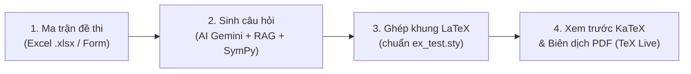

# MathForge

Ứng dụng hỗ trợ giáo viên tạo đề Toán theo ma trận và xuất đề. Xem [nguồn chính thức và ma trận tham khảo Toán lớp 6–12](MA_TRAN_TOAN.md) để đối chiếu dữ liệu của thư viện trước khi dùng.

---

## 1. Luồng xử lý cốt lõi 4 bước (Core Workflow Pipeline)



1. **Input & Parsing (Đầu vào ma trận):**
   * Hỗ trợ tải file Excel ma trận (.xlsx) hoặc cấu hình trực tiếp trên Web.
   * Cung cấp sẵn **Ma trận chuẩn 22 câu đề thi Tốt nghiệp THPT 2025** của Bộ GD&ĐT:
     * **Phần I:** 12 câu trắc nghiệm 4 lựa chọn (3.0 điểm).
     * **Phần II:** 4 câu trắc nghiệm Đúng/Sai với 4 ý $a, b, c, d$ (4.0 điểm).
     * **Phần III:** 6 câu trắc nghiệm trả lời ngắn điền số (3.0 điểm).
   * Có nút tải file mẫu Excel chuẩn để giáo viên chỉnh sửa theo trường/lớp.

2. **Question Generation (AI + RAG + Kiểm chứng SymPy):**
   * Sử dụng Gemini Structured Output ép kiểu JSON chặt chẽ.
   * Tích hợp **Ngân hàng câu hỏi mồi (Few-Shot / RAG)** cho từng chuyên đề (Hàm số, Oxyz, Tích phân, Xác suất).
   * **Cơ chế Chain-of-Thought:** Yêu cầu AI giải từng bước trước khi chốt đáp án.
   * **SymPy Guardrail:** Chạy máy tính đại số SymPy để kiểm tra tính đúng đắn của nghiệm, đạo hàm, khoảng cách. Nếu sai tự động phản biện để sửa.
   * **Chế độ Offline:** Hoạt động hoàn chỉnh ngay cả khi chưa nhập API key nhờ bộ sinh ngẫu nhiên số liệu chuẩn.

3. **LaTeX Templating (Ghép khung chuẩn `ex_test.sty`):**
   * Xuất mã nguồn `.tex` chuẩn các macro giáo viên quen dùng:
     * Trắc nghiệm 4 lựa chọn: `\begin{ex} ... \choice{...}{...}{...}{...} \loigiai{...} \end{ex}`
     * Trắc nghiệm Đúng/Sai: `\choiceTF{\True ...}{...}{\True ...}{...}`
     * Trả lời ngắn: `\shortans{...}`
     * Tự luận: `\begin{bt} ... \loigiai{...} \end{bt}`
   * Đính kèm Header trường, kỳ thi, mã đề và **Bảng đáp án tổng hợp** tự động ở cuối trang.

4. **Preview & Compile (Xem trước & Xuất bản):**
   * Hiển thị trực quan từng câu hỏi với bộ render công thức toán **KaTeX**.
   * Nút **"Đổi câu khác"** cho từng câu hỏi riêng biệt kèm ô nhập yêu cầu chi tiết.
   * Cho phép chỉnh sửa nhanh đề bài ngay trên giao diện.
   * Xem trước mã LaTeX, sao chép 1-click hoặc tải về file `.tex`.
   * Hỗ trợ container TeX Live Docker để biên dịch PDF độc lập.

---

## 2. Cấu trúc dự án

```
d:\project\Thư mục mới\
├── backend/
│   ├── app/
│   │   ├── api/endpoints.py       # API endpoints (Ma trận, Sinh câu, Export, Verify)
│   │   ├── models/question.py     # Pydantic Schemas cho 4 dạng câu hỏi GDPT 2018
│   │   ├── services/
│   │   │   ├── ai_service.py      # Tích hợp Gemini + RAG + Offline Fallback
│   │   │   ├── latex_service.py   # Ghép khung LaTeX chuẩn ex_test.sty
│   │   │   ├── sympy_service.py   # Máy tính đại số SymPy kiểm chứng toán học
│   │   │   ├── matrix_service.py  # Đọc/ghi Excel ma trận (openpyxl)
│   │   │   ├── tikz_service.py    # Mẫu bảng biến thiên tkz-tab & hình không gian
│   │   │   └── compiler_service.py# Bộ biên dịch TeX Live (Docker / local)
│   │   └── templates/
│   │       └── ex_test.py         # Định nghĩa mã nguồn gói ex_test.sty
│   ├── main.py                    # Khởi chạy server FastAPI phục vụ cả API và Web UI
│   └── test_pipeline.py           # Bộ kiểm thử tự động toàn diện
├── frontend/                      # Giao diện Web (Vite + React + Tailwind + KaTeX + Lucide)
│   ├── src/
│   │   ├── components/
│   │   │   ├── MathView.tsx       # Component render công thức KaTeX an toàn
│   │   │   ├── QuestionCard.tsx   # Card hiển thị câu hỏi, đáp án, lời giải, nút đổi câu
│   │   │   ├── MatrixManager.tsx  # Bảng quản lý và tải lên ma trận
│   │   │   ├── ExportModal.tsx    # Modal xem trước code LaTeX và tải file
│   │   │   └── SettingsModal.tsx  # Cấu hình Gemini API key & trạng thái hệ thống
│   │   └── App.tsx                # Trang chủ ứng dụng
│   └── dist/                      # Bản build giao diện đã tối ưu hóa
├── latex_compiler/                # Cấu hình container Docker TeX Live
│   ├── Dockerfile
│   └── ex_test.sty
├── start.bat                      # File khởi chạy 1-click trên Windows
└── README.md
```

---

## 3. Hướng dẫn khởi chạy

### Cách 1: Khởi chạy 1-Click (Khuyên dùng trên Windows)
Chỉ cần nhấp đúp chuột vào file:
```
start.bat
```
Sau đó mở trình duyệt truy cập: **`http://127.0.0.1:8000`**

### Cách 2: Khởi chạy bằng lệnh Terminal
```powershell
# Chạy Backend (tự động phục vụ cả Web UI đã build):
python backend\main.py
```

### Cách 3: Chế độ Phát triển Frontend (Live Hot-Reload):
Nếu muốn chỉnh sửa mã nguồn giao diện:
```powershell
cd frontend
npm run dev
# Mở http://localhost:5173
```

---

## 4. Kiểm thử hệ thống (Automated Tests)
Hệ thống đi kèm kịch bản kiểm thử toàn diện cả 7 bước của luồng xử lý:
```powershell
python backend\test_pipeline.py
```
Kết quả kiểm tra:
* ✅ Kiểm tra trạng thái Backend
* ✅ Nạp ma trận chuẩn 22 câu Bộ GD&ĐT 2025
* ✅ Tải mẫu file Excel ma trận
* ✅ Sinh câu hỏi Phần I, II, III
* ✅ Kiểm chứng tính toán bằng SymPy
* ✅ Ghép mã nguồn LaTeX chuẩn `ex_test.sty`
* ✅ Phục vụ Web UI Single Page Application
